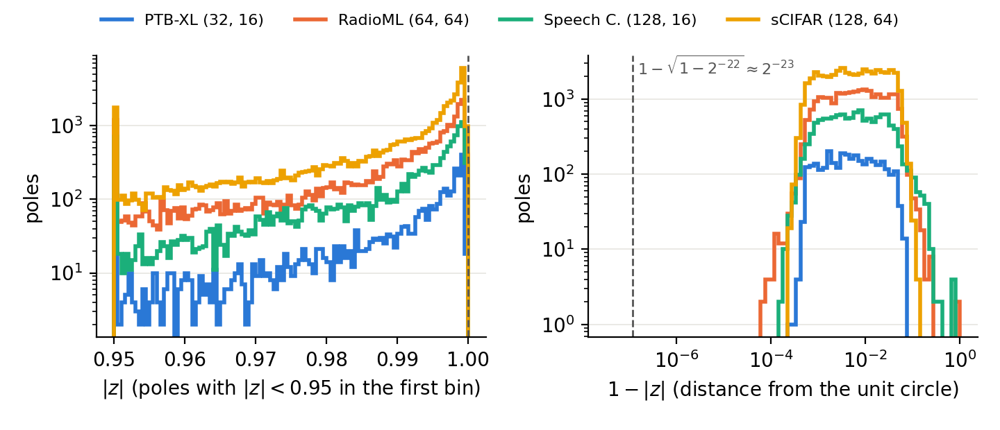
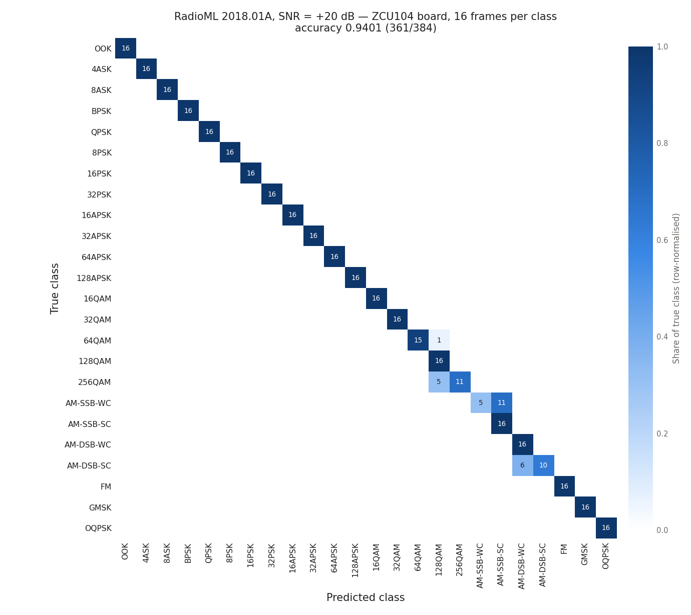
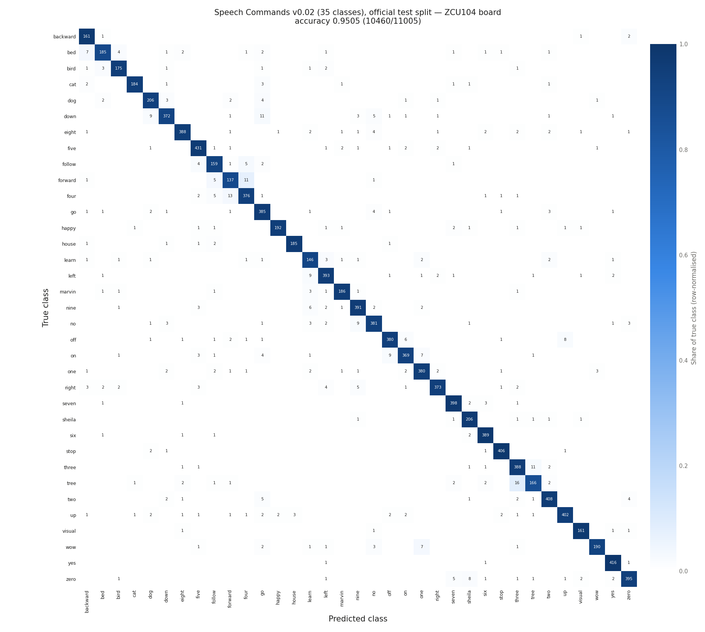
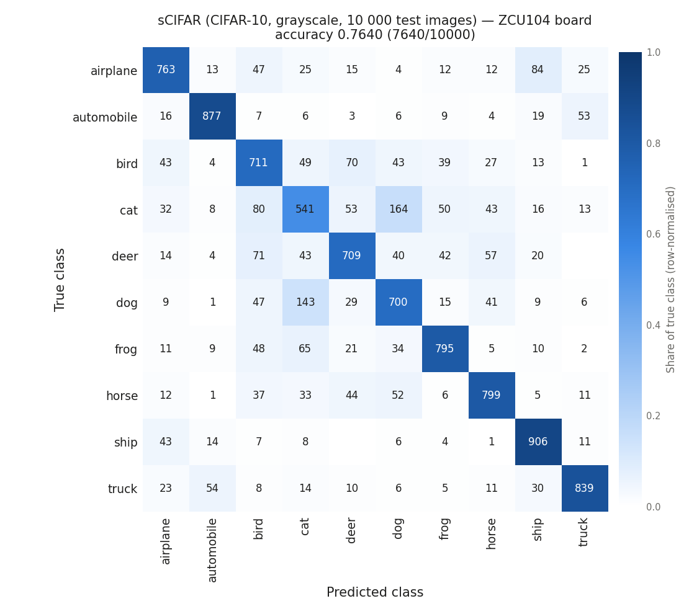

# S4D accelerator on ZCU104

FPGA accelerator for **S4D** (diagonal structured state-space) neural networks on the AMD/Xilinx **ZCU104** board (Zynq UltraScale+ `xczu7ev-ffvc1156-2-e`).

One parametric RTL core runs four sequence-classification tasks. Each task is a separate block design: the core is instantiated with the size of the model selected for that task (H channels, N = 2 × MODES states per channel), and the weights (`.mem`) are loaded into on-chip ROM.

| Task | Dataset | Input per time step | Classes | Model (H, N) | Parameters | Block design |
|---|---|---|---|---|---|---|
| ECG | PTB-XL 1.0.3, superdiagnostic, 100 Hz | 12 leads, int16 | 5 (multi-label) | (32, 16) | 20,229 | `S4D_PTB_XL` |
| RadioML | RadioML 2018.01A | I and Q, int16 | 24 | (64, 64) | 102,488 | `S4D_RadioML` |
| Speech Commands | Speech Commands v0.02, 12 kHz | 12 audio samples, int16 | 35 | (128, 16) | 232,227 | `S4D_S_C` |
| sCIFAR | CIFAR-10, sequential grayscale | 1 pixel, uint8 | 10 | (128, 64) | 301,322 | `S4D_sCIFAR` |


All models have L = 1024 time steps and 6 S4D layers. The size of each model is the smallest (H, N) whose validation metric stays within a fixed tolerance of the best one in a sweep over H ∈ {32, 64, 128} and N ∈ {16, 32, 64, 128} (scripts in `training/sizing/`). All arithmetic is fixed-point, and the logits read from the board are **bit-exact** with the fixed-point software model in `python/s4d_golden.py`.

## Repository layout

```
rebuild_S4D_ZCU104.tcl   recreates the Vivado project with the 4 block designs
src/new/                 RTL (Verilog), parametric in H and MODES
  s4d_core_axis.v          S4D core: 6 layers, AXI-Stream in/out
  s4d_layer.v              one S4D layer: affine norm, biquad bank, GELU, mixing + GLU, residual
  s4d_biquad_bank.v, s4d_biquad_unit.v   NUNITS biquad units x NCH channels x MODES modes
  s4d_mixing_glu.v         NMAC = 2H MACs (weights in URAM), GLU
  s4d_affine.v, s4d_pwl.v, s4d_seqbuf.v, s4d_wload_axis.v, s4d_stim_src.v
  s4d_encoder_axis.v       generic encoder (NIN inputs of N_BIT_IN bits -> H channels)
  s4d_decoder_axis.v       final affine norm, mean pool, INT8 classifier
  s4d_weightrom_axis.v     on-chip weight ROM, streams one layer at a time to the core
src/bd/<block design>/   the four block designs (.bd and IP configurations)
mem/mem_ECG/ mem_RadioML/ mem_SP/ mem_sCIFAR/
                         weights and lookup tables of each task (9 files each)
board/                   test on the board
  make_board_files.py      generates the input samples streamed to the board, the labels and the
                           golden logits (bit-exact model) from the public datasets
  radioml_test_frames.txt  indices of the 9984 RadioML test frames in the HDF5 file (input of make_board_files.py)
  <task>/s4d_ZCU104_*.c    test program of each task: bit-exactness, metric, time, energy
  <task>/logits_board_*.bin    logits read back from the board in the measured runs
python/
  s4d_golden.py            bit-exact fixed-point model of the accelerator (reads mem/), any H and N
  plot_poles.py            poles of the quantized biquads -> images/quantized_poles.*
  arch_diagram.py          draws images/architecture.pdf and .png
training/                training and quantization scripts (see training/README.md)
  sizing/                  (H, N) sweep, quantization and fine-tuning of the selected models
images/                  architecture diagram, confusion matrices, quantized poles
```

## Rebuilding the Vivado project

Requires Vivado **2025.2**. From the Vivado Tcl console:

```
source <repository>/rebuild_S4D_ZCU104.tcl
```

or in batch mode from the repository folder:

```
vivado -mode batch -source rebuild_S4D_ZCU104.tcl
```

The project is created in `vivado/S4D_ZCU104/` with the four block designs and their wrappers; the top is `S4D_PTB_XL_wrapper`. Select the task with `set_property top <wrapper> [current_fileset]`:

| Top | Task |
|---|---|
| `S4D_PTB_XL_wrapper` | ECG |
| `S4D_RadioML_wrapper` | RadioML |
| `S4D_S_C_wrapper` | Speech Commands |
| `S4D_sCIFAR_wrapper` | sCIFAR |

Synthesis and implementation are not started automatically. The `.bit.bin` for the FPGA Manager is produced from the `.bit` with:

```
echo all:{ S4D_PTB_XL_wrapper.bit } > S4D_PTB_XL_wrapper.bif
bootgen -image S4D_PTB_XL_wrapper.bif -arch zynqmp -process_bitstream bin -o S4D_PTB_XL_wrapper.bit.bin -w
```

Every block design contains:
- the Zynq UltraScale+ PS, with PL0 at 230 MHz requested (213.33 MHz actual);
- an AXI DMA in simple mode at `0xA000_0000`: MM2S (64 bit) feeds the encoder, S2MM (32 bit) receives the logits;
- the encoder, the S4D core, the decoder and the weight ROM.

The DMA reaches DDR through `S_AXI_HPC0`.

### Block design parameters

| Generic | ECG | RadioML | Speech Commands | sCIFAR |
|---|---|---|---|---|
| core `H` / `LOG2_H` | 32 / 5 | 64 / 6 | 128 / 7 | 128 / 7 |
| core `MODES` / `LOG2_MOD` | 8 / 3 | 32 / 5 | 8 / 3 | 32 / 5 |
| core `NUNITS` / `NCH` / `LOG2_NB` | 16 / 2 / 4 | 32 / 2 / 6 | 32 / 4 / 5 | 32 / 4 / 7 |
| core `NMAC` | 64 | 128 | 256 | 256 |
| core `F_SSM` / `F_D` | 7 / 13 | 9 / 13 | 9 / 13 | 8 / 13 |
| encoder `H` / `NIN` / `N_BIT_IN` / `IN_SIGNED` | 32 / 12 / 16 / 1 | 64 / 2 / 16 / 1 | 128 / 12 / 16 / 1 | 128 / 1 / 8 / 0 |
| encoder `F_WENC` | 31 | 35 | 32 | 26 |
| decoder `H` / `K` | 32 / 5 | 64 / 24 | 128 / 35 | 128 / 10 |
| decoder `BN_SH` / `RQ_SHIFT` | 10 / 7 | 7 / 8 | 8 / 7 | 12 / 6 |
| weight ROM `NBEAT` (beats per layer) | 1057 | 5953 | 8833 | 14977 |

`NUNITS × NCH = H` and `NCH ≥ 2` (the RTL uses `[LOG2_NCH-1:0]` registers). `NBEAT = 1 + H·N + 5H + 2H²·12/64`.

## Running on the board

The tests were run on a ZCU104 with the PYNQ Linux image, from Linux userspace (`/dev/mem`, no kernel driver).

1. **Test files.** Generate them from the public datasets; they are not in the repository because they are large (up to 270 MB):
   ```
   cd board
   python make_board_files.py ECG     --data /path/to/ptb-xl
   python make_board_files.py RadioML --data /path/to/GOLD_XYZ_OSC.0001_1024.hdf5
   python make_board_files.py SC      --data /path/to/speech_commands_v0.02
   python make_board_files.py sCIFAR  --data /path/to/cifar-10-batches-py
   ```
   Each command writes into `board/<task>/`, next to the C program:
   - the input samples (`samples_*.bin`);
   - the labels (`labels_*.bin`, plus `snr_RadioML_9984.bin` for RadioML);
   - the golden logits (`logits_golden_*.bin`) of the bit-exact model, on every test example (sCIFAR: first 1000 images).
2. **Copy to the board** the task folder and build the test program:
   ```
   gcc -O2 -o s4d_ZCU104_PTB_XL_H32_N16 s4d_ZCU104_PTB_XL_H32_N16.c -lpthread
   ```
3. **Set the PL clock** to 214.28 MHz (IOPLL / 7, register `PL0_REF_CTRL` of the PS), without exceeding the frequency at which the bitstream met timing, and **load the `.bit.bin`** of the same task with the Linux FPGA Manager (`/sys/class/fpga_manager/fpga0`).
4. **Run the test:**
   ```
   sudo ./s4d_ZCU104_PTB_XL_H32_N16 [N_EXAMPLES] [DDR_BASE_HEX] [ENERGY_SECONDS]
   ```
   (sCIFAR: `sudo ./s4d_ZCU104_sCIFAR_paper 1000`, the golden covers the first 1000 images.)

The program prints:
1. the bit-exact comparison of every logit with the golden;
2. the quality metric of the task, computed on the board logits;
3. the total and mean inference time, and the cycles, using the PL clock read from the PS registers;
4. the power of the on-board sensors at idle and during 10 s of consecutive inferences, and the energy per inference.

It also saves `logits_board_*.bin`.

The DMA buffers are placed at physical address `0x7000_0000` (1 MB). This region must not be used by Linux, for example through a `no-map` reserved-memory node; see the header of the C programs. A different address can be passed as the second argument of the program.

## Results measured on the board

All values below were measured on the ZCU104 at **pl_clk0 = 214.28 MHz**, in fixed point.

### Quality

Each task uses the standard metric of its benchmark:
- **ECG:** macro AUC, as in the PTB-XL superdiagnostic benchmark (fold 10).
- **RadioML:** accuracy averaged over all SNRs, plus the accuracy at +10 dB and at +20 dB.
- **Speech Commands and sCIFAR:** top-1 accuracy on the official test set.

| Task | Test examples | Metric | Float model | **ZCU104** |
|---|---|---|---|---|
| ECG | 2158 (fold 10) | macro AUC | 0.9228 | **0.9196** |
| RadioML | 9984 (16 per class and SNR) | accuracy, all SNRs | 0.6113 | **0.6039** |
| | | accuracy at SNR = +10 dB | 0.953 | **0.932** |
| | | accuracy at SNR = +20 dB | 0.956 | **0.940** |
| Speech Commands | 11005 (official test split) | top-1 accuracy | 0.9506 | **0.9505** |
| sCIFAR | 10000 (CIFAR-10 test set) | top-1 accuracy | 0.7637 | **0.7640** |

Speech Commands: float model after the saturation-aware fine-tuning (clamp at ±16 on the norm outputs).

### Bit-exactness

| Task | Logits compared with the golden | Result |
|---|---|---|
| ECG | all 2158 records | 2158/2158 identical (0/10,790 logits differ) |
| RadioML | all 9984 frames | 9984/9984 identical (0/239,616) |
| Speech Commands | all 11005 recordings | 11005/11005 identical (0/385,175) |
| sCIFAR | first 1000 images | 1000/1000 identical, and 7640/10000 correct as in the fixed-point model |

### Latency

| Task | Inference time (mean) | Cycles per inference | Cycles per time step per layer | Throughput |
|---|---|---|---|---|
| ECG | 1.309 ms | 280,462 | 45.6 | 764.0 inf/s |
| RadioML | 2.662 ms | 570,503 | 92.9 | 375.6 inf/s |
| Speech Commands | 4.746 ms | 1,016,930 | 165.5 | 210.7 inf/s |
| sCIFAR | 5.063 ms | 1,084,960 | 176.6 | 197.5 inf/s |

The time is measured from the start of the input DMA to the last logit in DDR; cycles = mean time × 214.28 MHz.

### Power and energy

Measured with the board sensors (`/sys/class/hwmon`): the INA226 on the 12 V input of the board and output 1 of the IRPS5401 regulator at I²C address 0x43, which supplies VCCINT (0.85 V). For each task the board first idles for 3 s with the bitstream loaded, then runs 10 s of consecutive inferences on the same example, already in DDR. Energy per inference = power × time per inference; "Δ" uses the increase over idle.

| Task | 12 V: idle → active (W) | Energy / inference, 12 V (mJ) | Δ (mJ) | VCCINT: idle → active (W) | Energy / inference, VCCINT (mJ) | Δ (mJ) |
|---|---|---|---|---|---|---|
| ECG | 10.82 → 11.33 | 14.8 | 0.66 | 1.78 → 2.25 | 2.94 | 0.61 |
| RadioML | 11.31 → 12.55 | 33.4 | 3.29 | 2.25 → 3.26 | 8.68 | 2.69 |
| Speech Commands | 11.56 → 12.69 | 60.2 | 5.34 | 2.50 → 3.41 | 16.2 | 4.32 |
| sCIFAR | 11.64 → 13.83 | 70.0 | 11.08 | 2.50 → 4.30 | 21.8 | 9.10 |

### Implementation (Vivado 2025.2, routed, constraint 4.687 ns = 213.36 MHz)

| Task | WNS | WHS | WPWS | Fmax (from WNS) | LUT | FF | BRAM tiles | URAM | DSP | Power (est.) |
|---|---|---|---|---|---|---|---|---|---|---|
| ECG | +0.803 ns | +0.010 ns | +0.843 ns | ~257 MHz | 23,421 | 33,306 | 40.5 | 12 | 192 | 4.041 W |
| RadioML | +0.746 ns | +0.009 ns | +0.843 ns | ~254 MHz | 42,946 | 58,379 | 167.5 | 24 | 359 | 5.324 W |
| Speech Commands | +0.431 ns | +0.010 ns | +0.843 ns | ~235 MHz | 56,469 | 71,755 | 203.5 | 48 | 497 | 5.868 W |
| sCIFAR | +0.325 ns | +0.010 ns | +0.843 ns | ~229 MHz | 66,161 | 70,494 | 263 | 48 | 486 | 6.112 W |

Power: Vivado vectorless estimates for the whole chip, PS included (PS8 2.22 W). sCIFAR: implementation of the bitstream used for the board results (same H = 128, N = 64 configuration and weights).

### Quantized poles

The biquad coefficients a1, a2 are 24-bit integers with 22 fractional bits. No quantized pole reaches the unit circle: the closest one (RadioML) is at 1 − |z| = 7.5·10⁻⁵, about 600 times the quantization limit 1 − √(1 − 2⁻²²) ≈ 2⁻²³. `python/plot_poles.py` writes the figure and the pole lists (`images/poles_<task>.txt`).



### Confusion matrices

Built from the logits read back from the board (`board/<task>/logits_board_*.bin`) and the labels written by `make_board_files.py`. PDF versions for the paper are in `images/`.

**RadioML 2018.01A, SNR = +10 dB** (16 frames per class):


**RadioML 2018.01A, SNR = +20 dB** (16 frames per class):



**Speech Commands v0.02**, official test split (11005 recordings):



**sCIFAR**, CIFAR-10 test set (10000 images):



## Training and quantization

`training/` contains the scripts that trained the models and produced the `.mem` files: one training script per task, the quantization scripts, and `make_fpga_mem.py`, which turns a quantization output into the files of `mem/mem_<task>/` for any (H, N). `training/sizing/` contains the (H, N) sweep and the quantization and fine-tuning of the selected models. The full workflow is in [`training/README.md`](training/README.md).

## Bit-exact model

`python/s4d_golden.py` reads the same `.mem` files that are loaded into the FPGA and reproduces the integer arithmetic of the RTL: shifts with rounding, saturation, the piecewise-linear GELU and sigmoid, and the per-channel exponents of the biquads. H and MODES are read from the `.mem` files.

Example: compare the model with the board logits on 64 recordings (the samples are generated first with `board/make_board_files.py`):
```
cd python
python s4d_golden.py SC --samples ../board/SpeechCommands/samples_SC_11005.bin \
                        --board   ../board/SpeechCommands/logits_board_ZCU104_SC_H128_N16.bin -n 64
```

The model needs only `numpy`. Regenerating the input files also needs `pandas` (ECG), `h5py` (RadioML), `scipy` and `soundfile` (Speech Commands), and `Pillow` (sCIFAR); training needs PyTorch. All versions are in `requirements.txt`.

## Datasets

- **PTB-XL:** Wagner et al., PhysioNet, 2020.
- **RadioML 2018.01A:** O'Shea et al., DeepSig.
- **Speech Commands v0.02:** Warden, 2018.
- **CIFAR-10:** Krizhevsky, 2009.

The datasets are not included; download them from their original sources under their own licenses.
