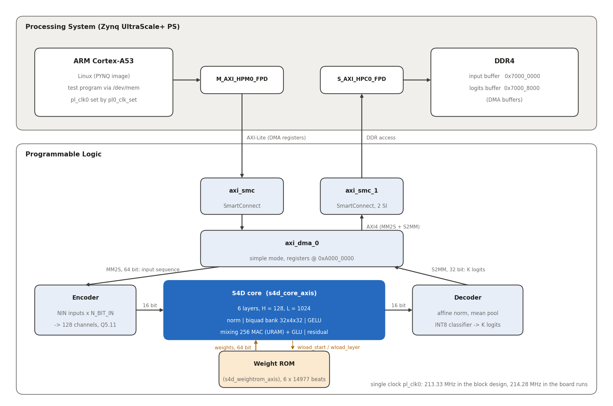
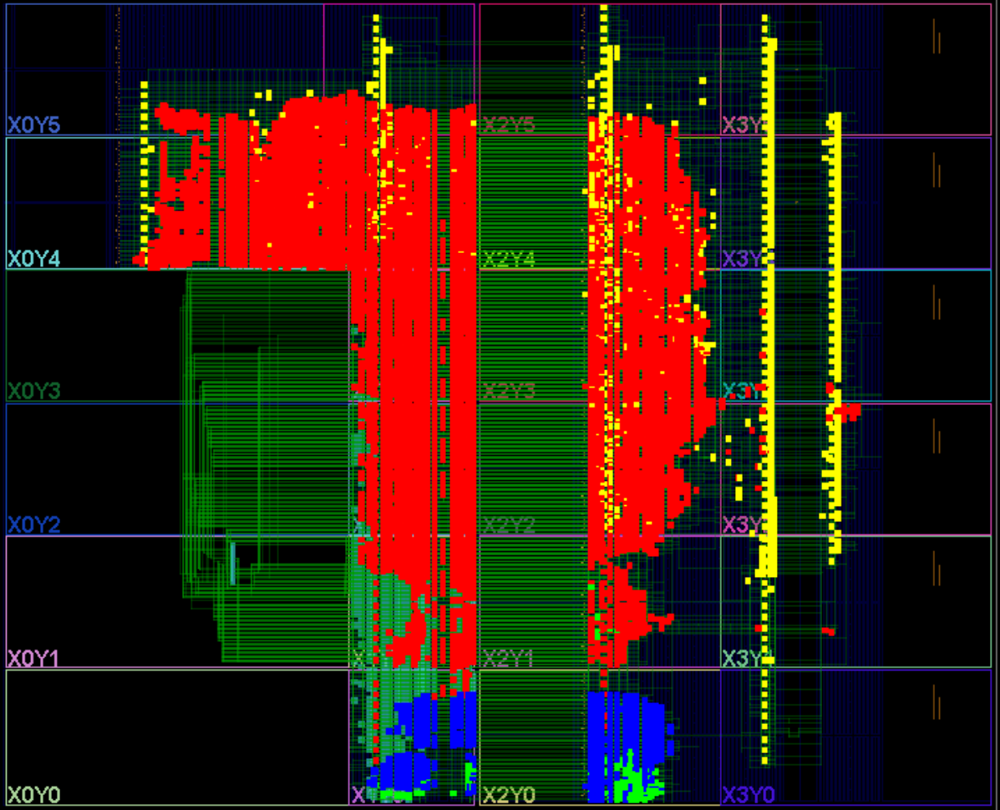
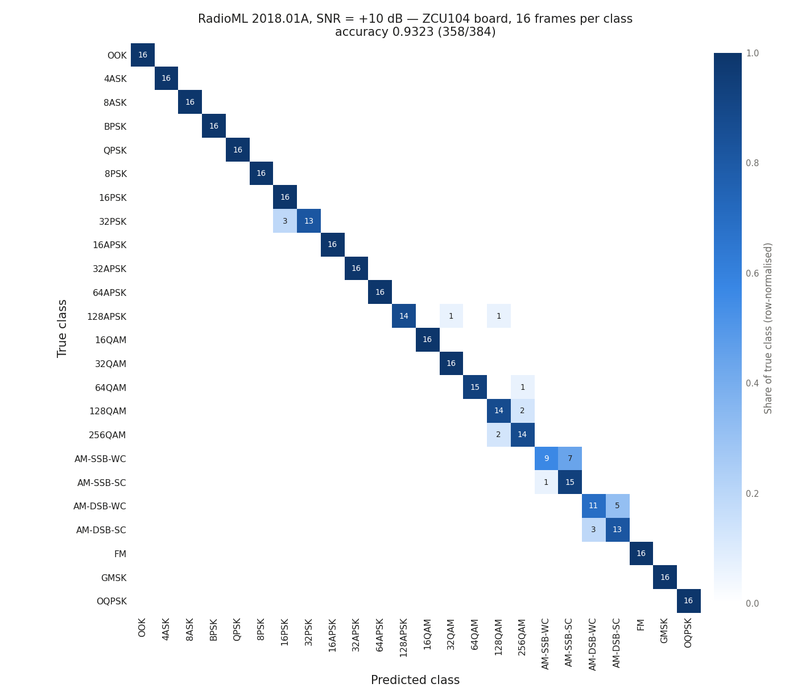
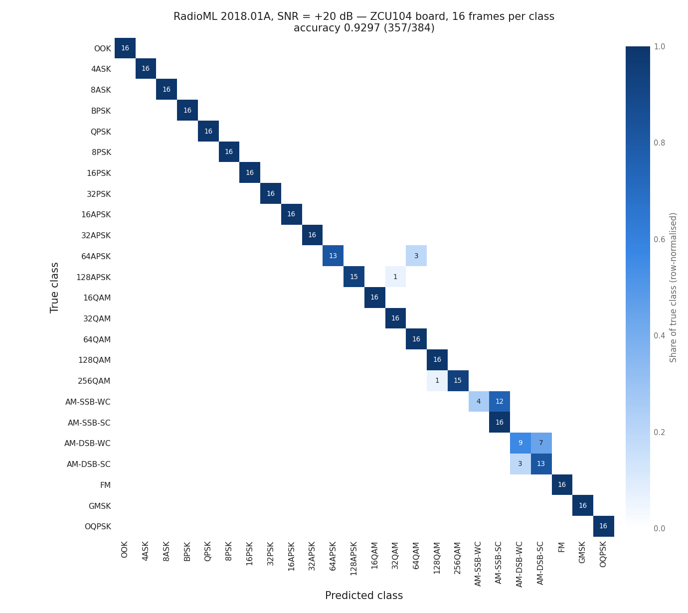
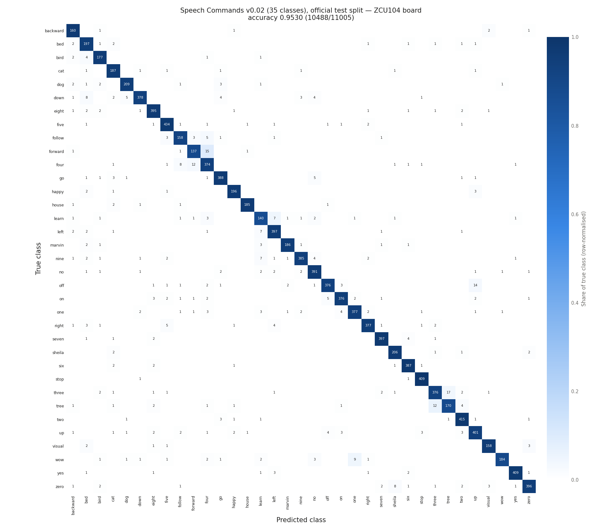
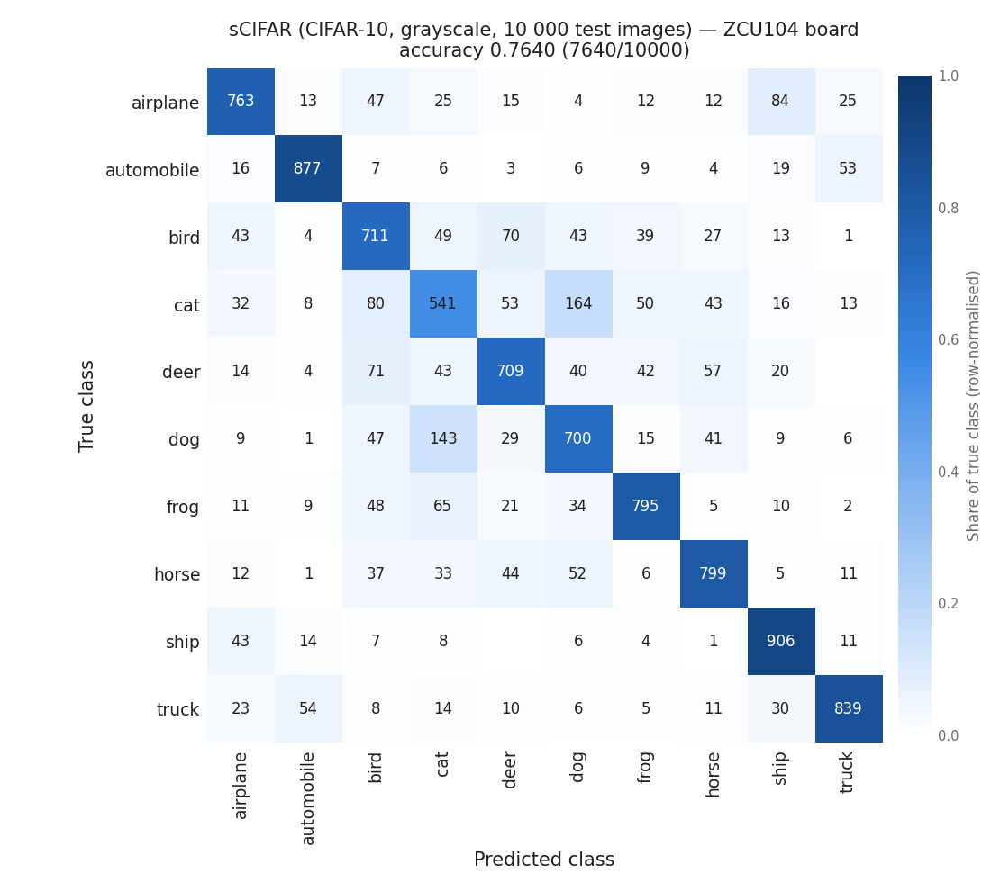

# S4D accelerator on ZCU104

FPGA accelerator for **S4D** (diagonal structured state-space) neural networks on the AMD/Xilinx **ZCU104** board (Zynq UltraScale+ `xczu7ev-ffvc1156-2-e`).

One RTL core runs four different sequence-classification tasks. Each task is a separate block design that differs only in the generics and in the weight files (`.mem`) loaded into on-chip ROM:

| Task | Dataset | Input per time step | Classes | Block design |
|---|---|---|---|---|
| ECG | PTB-XL 1.0.3, superdiagnostic, 100 Hz | 12 leads, int16 | 5 (multi-label) | `S4D_PTB_XL` |
| RadioML | RadioML 2018.01A | I and Q, int16 | 24 | `S4D_RadioML` |
| Speech Commands | Speech Commands v0.02, 12 kHz | 12 audio samples, int16 | 35 | `S4D_S_C` |
| sCIFAR | CIFAR-10, sequential grayscale | 1 pixel, uint8 | 10 | `S4D_sCIFAR` |



The architecture is the same for every task: H = 128 channels, L = 1024 time steps, 6 S4D layers, 32 modes per channel. All arithmetic is fixed-point, and the logits read from the board are **bit-exact** with the fixed-point software model in `python/s4d_golden.py`.

## Repository layout

```
rebuild_S4D_ZCU104.tcl   recreates the Vivado project with the 4 block designs
new/                     RTL (Verilog)
  s4d_core_axis.v          S4D core: 6 layers, AXI-Stream in/out
  s4d_layer.v              one S4D layer: affine norm, biquad bank, GELU, mixing + GLU, residual
  s4d_biquad_bank.v, s4d_biquad_unit.v   32 biquad units x 4 channels x 32 modes
  s4d_mixing_glu.v         256 MACs (weights in URAM), GLU
  s4d_affine.v, s4d_pwl.v, s4d_seqbuf.v, s4d_wload_axis.v
  s4d_encoder_axis.v       generic encoder (NIN inputs of N_BIT_IN bits -> 128 channels)
  s4d_decoder_axis.v       final affine norm, mean pool, INT8 classifier
  s4d_weightrom_axis.v     on-chip weight ROM, streams one layer at a time to the core
mem_ECG/ mem_RadioML/ mem_SP/ mem_sCIFAR/
                         weights and lookup tables of each task (9 files each)
board/                   everything needed for the test on the board
  make_board_files.py      generates the test files of each task from the public datasets
  radioml_test_frames.txt  indices of the 9984 RadioML test frames in the HDF5 file
  pl0_clk_set.c            sets the PL clock with the PS dividers only (PLLs untouched)
  <task>/s4d_ZCU104_*.c    test program of each task (ECG, RadioML, SpeechCommands, sCIFAR)
  <task>/logits_board_*.bin    logits read back from the board in the measured runs
  paper_confusion.py       confusion matrices from the board logits -> images/
python/
  s4d_golden.py            bit-exact fixed-point model of the accelerator (reads mem_*/)
  arch_diagram.py          draws images/architecture.pdf and .png
training/                training and quantization scripts used for the four models
                         (see training/README.md)
images/                  architecture diagram, confusion matrices, device view (PDF and PNG)
```

## Rebuilding the Vivado project

Requires Vivado **2025.2**. From the repository folder:

```
vivado -mode batch -source rebuild_S4D_ZCU104.tcl -tclargs --top S4D_PTB_XL_wrapper
```

`--top` selects the task to implement:

| `--top` | Task |
|---|---|
| `S4D_PTB_XL_wrapper` | ECG |
| `S4D_RadioML_wrapper` | RadioML |
| `S4D_S_C_wrapper` | Speech Commands |
| `S4D_sCIFAR_wrapper` (default) | sCIFAR |

The project is created in `build/S4D_ZCU104/`. All four block designs are created in the same project, so the top can be changed later with `set_property top <wrapper> [current_fileset]`. The script checks that all source files are present, then recreates the block designs from Tcl. Synthesis and implementation are not started automatically.

Every block design contains:
- the Zynq UltraScale+ PS, with PL0 at 230 MHz requested (213.33 MHz actual);
- an AXI DMA in simple mode at `0xA000_0000`: MM2S (64 bit) feeds the encoder, S2MM (32 bit) receives the logits;
- the encoder, the S4D core, the decoder and the weight ROM.

The DMA reaches DDR through `S_AXI_HPC0`.

### Block design parameters

| Generic | ECG | RadioML | Speech Commands | sCIFAR |
|---|---|---|---|---|
| encoder `NIN` / `N_BIT_IN` / `IN_SIGNED` | 12 / 16 / 1 | 2 / 16 / 1 | 12 / 16 / 1 | 1 / 8 / 0 |
| encoder `F_WENC` | 31 | 34 | 31 | 26 |
| core `F_SSM` | 9 | 9 | 9 | 8 |
| decoder `K` | 5 | 24 | 35 | 10 |
| decoder `BN_SH` / `RQ_SHIFT` | 13 / 6 | 8 / 8 | 9 / 7 | 12 / 6 |

## Running on the board

The tests were run on a ZCU104 with the PYNQ Linux image, as root, from Linux userspace (`/dev/mem`, no kernel driver).

1. **Test files.** Generate them from the public datasets; they are not in the repository because they are large (up to 270 MB):
   ```
   cd board
   python make_board_files.py ECG     --data /path/to/ptb-xl
   python make_board_files.py RadioML --data /path/to/GOLD_XYZ_OSC.0001_1024.hdf5
   python make_board_files.py SC      --data /path/to/speech_commands_v0.02
   python make_board_files.py sCIFAR  --data /path/to/cifar-10-batches-py
   ```
   Each command writes into `board/<task>/`, next to the C program:
   - the input samples (`samples_*.bin`);
   - the labels (`labels_*.bin`, plus `snr_RadioML_9984.bin` for RadioML);
   - the golden logits (`logits_golden_*.bin`), computed with the bit-exact model.

   The files produced are byte-identical to the ones used for the measurements below.
2. **Copy to the board.** Copy the task folder and `pl0_clk_set.c` to the board, then build:
   ```
   gcc -O2 -o pl0_clk_set pl0_clk_set.c -lm
   gcc -O2 -o s4d_ZCU104_2158ECG s4d_ZCU104_2158ECG.c
   ```
3. **Load the bitstream** of the same task.
4. **Set the PL clock**, without exceeding the frequency at which the bitstream met timing (table below):
   ```
   sudo ./pl0_clk_set 220        # highest frequency <= 220 MHz: IOPLL/7 = 214.28 MHz
   ```
5. **Run the test:**
   ```
   sudo ./s4d_ZCU104_2158ECG
   ```

The program prints:
- the bit-exact comparison with the golden logits;
- the quality metric of the task;
- the inference time and the cycles, using the PL clock read from the PS registers.

It also saves `logits_board_*.bin`.

The DMA buffers are placed at physical address `0x7000_0000` (1 MB). This region must not be used by Linux, for example through a `no-map` reserved-memory node; see the header of the C programs. A different address can be passed as the second argument of the program.

## Results measured on the board

All values below were measured on the ZCU104 at **pl_clk0 = 214.28 MHz**, in fixed point. In every task, the board logits are identical to the bit-exact model.

### Quality

Each task uses the standard metric of its benchmark:
- **ECG:** macro AUC, as in the PTB-XL superdiagnostic benchmark (fold 10).
- **RadioML:** accuracy averaged over all SNRs, plus the accuracy at +10 dB and at +20 dB.
- **Speech Commands and sCIFAR:** top-1 accuracy on the official test set.

| Task | Test examples | Metric | Float model | **ZCU104** |
|---|---|---|---|---|
| ECG | 2158 (fold 10) | macro AUC | 0.9255 | **0.9244** |
| RadioML | 9984 (16 per class and SNR) | accuracy, all SNRs | 0.6054 | **0.5995** |
| | | accuracy at SNR = +10 dB | 0.948 | **0.932** |
| | | accuracy at SNR = +20 dB | 0.935 | **0.930** |
| Speech Commands | 11005 (official test split) | top-1 accuracy | 0.9538 | **0.9530** |
| sCIFAR | 10000 (CIFAR-10 test set) | top-1 accuracy | 0.7637 | **0.7640** |

The difference from the float model comes entirely from quantization: the board reproduces the fixed-point model exactly.

### Bit-exactness

| Task | Logits compared with the golden | Result |
|---|---|---|
| ECG | first 1000 records | 1000/1000 identical |
| RadioML | all 9984 frames | 9984/9984 identical |
| Speech Commands | 10 recordings | 10/10 identical, and the number of correct predictions on the whole test set equals the fixed-point model (10488/11005) |
| sCIFAR | first 1000 images | 1000/1000 identical, and 7640/10000 correct as in the fixed-point model |

### Latency

The latency does not depend on the task:

| Quantity | Value |
|---|---|
| Inference time per example (min) | 5.063 ms at 214.28 MHz |
| Cycles per example | ~1.085 M (= 176.6 cycles per time step per layer) |
| Throughput | 197.5 inferences/s |

The time is measured from the start of the input DMA to the last logit in DDR. Only the input transfer differs between tasks: 0.587 ms for ECG and Speech Commands (24 KB), 0.457 ms for RadioML (4 KB) and 0.002 ms for sCIFAR (1 KB). It overlaps with the computation.

### Implementation (Vivado 2025.2, routed, constraint 4.687 ns = 213.36 MHz)

| Task | WNS | WHS | WPWS | Fmax (from WNS) | LUT | FF | BRAM tiles | URAM | DSP | Power (est.) |
|---|---|---|---|---|---|---|---|---|---|---|
| ECG | +0.338 ns | +0.010 ns | +0.843 ns | ~230 MHz | 65 454 | 70 774 | 265 | 48 | 497 | 5.979 W |
| RadioML | +0.017 ns | +0.010 ns | +0.843 ns | ~214.1 MHz | 67 160 | 71 427 | 264 | 48 | 487 | 5.989 W |
| Speech Commands | +0.200 ns | +0.010 ns | +0.843 ns | ~222.9 MHz | 68 824 | 73 241 | 268 | 48 | 497 | 6.090 W |
| sCIFAR | +0.325 ns | +0.010 ns | +0.843 ns | ~229.3 MHz | 66 161 | 70 494 | 263 | 48 | 486 | 6.112 W |

- **Power:** these are Vivado vectorless estimates for the whole chip, PS included; the S4D core alone is about 2.6 W.
- **RadioML:** 214.28 MHz is slightly above the Fmax derived for this bitstream. The run was bit-exact on all frames, but the timing margin at that frequency is zero.

**Placement on the device** (Speech Commands implementation; Vivado device view, clock regions X0Y0-X3Y5):



Colours: red = S4D core (`s4d_core_axis`), green = encoder, blue = decoder, yellow = weight ROM (`s4d_weightrom_axis`).

### Confusion matrices

Built from the logits read back from the board (`board/<task>/logits_board_*.bin`) with `board/paper_confusion.py`. The script needs the labels, so first run `make_board_files.py <task> --data ... --no-golden`. PDF versions for the paper are in `images/`.

**RadioML 2018.01A, SNR = +10 dB** (16 frames per class):



**RadioML 2018.01A, SNR = +20 dB** (16 frames per class):



**Speech Commands v0.02**, official test split (11005 recordings):



**sCIFAR**, CIFAR-10 test set (10000 images):



## Training and quantization

`training/` contains the scripts that trained the four models and produced the `.mem` files: one training script per task, an example quantization script (ECG) and `make_fpga_mem.py`, which turns a quantization output into the files of `mem_<task>/`. The full workflow is in [`training/README.md`](training/README.md).

## Bit-exact model

`python/s4d_golden.py` reads the same `.mem` files that are loaded into the FPGA and reproduces the integer arithmetic of the RTL: shifts with rounding, saturation, the piecewise-linear GELU and sigmoid, and the per-channel exponents of the biquads.

Example: compare the model with the board logits on 64 recordings (the samples are generated first with `board/make_board_files.py`):
```
cd python
python s4d_golden.py SC --samples ../board/SpeechCommands/samples_SC_11005.bin \
                        --board   ../board/SpeechCommands/logits_board_ZCU104_SC.bin -n 64
```

The model needs only `numpy`. Regenerating the input files also needs `pandas` (ECG), `h5py` (RadioML), `scipy` and `soundfile` (Speech Commands), and `Pillow` (sCIFAR); training needs PyTorch. All versions are in `requirements.txt`.

## Datasets

- **PTB-XL:** Wagner et al., PhysioNet, 2020.
- **RadioML 2018.01A:** O'Shea et al., DeepSig.
- **Speech Commands v0.02:** Warden, 2018.
- **CIFAR-10:** Krizhevsky, 2009.

The datasets are not included; download them from their original sources under their own licenses.
